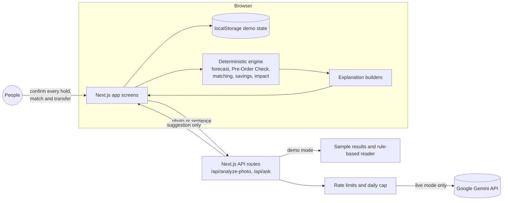

# Surplus AI

[](https://github.com/kavee05/surplus-ai/actions/workflows/ci.yml)

## Judges quick start

- **Live site:** https://surplus-ai.vercel.app (no sign-in, simulated data)
- **Guided demo (about two minutes):** on the home page click **Try the guided demo**. It runs a Pre-Order Check for 1,000 floor tiles at Bandar Bukit Raja (reserve 800, order 200, confirm by 24 Nov, an estimated RM 11,098 saved and 6.4 t of material reused), holds the forecast surplus, logs the real surplus by photo three weeks later, completes the transfer, and ends on Impact at RM 41,719.
- **Evidence and limits:** https://surplus-ai.vercel.app/app/evidence
- **Five files to read:**
  1. [src/lib/engine/forecast.ts](src/lib/engine/forecast.ts): surplus forecast from ordered versus planned quantities
  2. [src/lib/engine/preorder.ts](src/lib/engine/preorder.ts): the Pre-Order Check (reserve, order now, decision date)
  3. [src/lib/explain/builders.ts](src/lib/explain/builders.ts): the explanation behind every recommendation
  4. [src/lib/ai/ask.ts](src/lib/ai/ask.ts): Ask Surplus AI, with every AI-written number checked against the engine
  5. [src/components/network/surplus-network.tsx](src/components/network/surplus-network.tsx): the Surplus Network map of townships, transfers and forecasts
- **Keyboard:** Ctrl K (Cmd K on Mac) opens the command palette anywhere in the app.

**Check before you buy.** Surplus AI is a working prototype of a surplus platform that any township developer, contractor or site team in Malaysia could use. The demo uses Sime Darby Property townships as an example first pilot. Built for the Sime Darby Property (SDP) University Hackathon 2026, theme "Township of Tomorrow", Planet track (circular economy and waste management).

Construction teams order with a buffer, so usable material is left at the end of each phase while other phases buy the same items new. Surplus AI shows surplus across sites. Its main feature, **Surplus Radar**, forecasts surplus *before* it exists, from ordered versus planned quantities, and tells a buyer on another site to order less.

> Student prototype. Not affiliated with or endorsed by Sime Darby Property. All operational data is simulated.

## Run it

Requirements: Node.js 22 or newer, npm.

```bash
npm install
npm run dev
```

Open http://localhost:3000. Click **Try the guided demo** for the two-minute walkthrough.

Other scripts:

| Command | What it does |
| --- | --- |
| `npm test` | Vitest unit tests for forecast, Pre-Order Check, matching, savings and transfer workflow |
| `npm run lint` | ESLint |
| `npm run build` then `npm start` | Production build and server |
| `npm run test:e2e` | Playwright end-to-end tests against a production build (run `npx playwright install chromium` once) |

## Architecture



The AI suggests and summarises; the engine calculates every quantity; a person confirms every action. More detail: [docs/ARCHITECTURE.md](docs/ARCHITECTURE.md).

## Where AI is used

AI reads messy input and writes plain-language summaries. Deterministic code calculates. People approve.

- **Photo intake:** suggests item, condition and an estimated quantity from an uploaded photo; the engineer confirms before saving.
- **Ask Surplus AI:** reads a sentence such as "I need 1,000 floor tiles at Bandar Bukit Raja by 7 December", the engine runs the Pre-Order Check, and the model writes a short briefing that is shown only if every number matches the engine.
- **Not AI:** forecasting, matching, savings, carbon and certainty levels are plain, tested arithmetic.

Demo mode is the default and needs no key: sample photos have pre-written results, a rule-based reader handles requests, and summaries use a template. Every AI surface shows a Live AI or Demo mode badge. Details, providers, guardrails and limits: [docs/AI_USAGE.md](docs/AI_USAGE.md).

### Turning on live AI

Set these environment variables in your hosting provider (for Vercel: both Production and Preview), then redeploy:

```
LIVE_AI=true
GEMINI_API_KEY=...             # from Google AI Studio
GEMINI_MODEL=gemini-3.5-flash-lite
LIVE_AI_DAILY_CAP=200
UPSTASH_REDIS_REST_URL=...     # optional, shares limits across instances
UPSTASH_REDIS_REST_TOKEN=...
```

Check the result at `/api/ai-status?check=1`. It reports the mode, model and setup checks, never the key. The app uses the Google Gemini API only.

## Explainable recommendations

Every recommendation, match, forecast, photo suggestion and impact figure comes with a structured explanation built from the same data and logic that produced it: what to do, why, the evidence records, the calculation, the assumptions, the alternatives, and how strong the evidence is. Nothing shows a calibrated probability, because none exists yet. Consequential actions need confirmation, rejections need a reason, and every decision is kept on the Activity page. Details: [docs/EXPLAINABILITY.md](docs/EXPLAINABILITY.md).

## What is real and what is simulated

| Real | Simulated or assumed |
| --- | --- |
| SDP township names (used for realism) | Every quantity, phase, listing, need, transfer, person and company |
| Evidence figures on the Evidence page, with sources and limits | Township coordinates (approximate centres) |
| The forecast, matching and savings arithmetic | All costs, weights, carbon factors, lead times and wastage allowances (tagged ASSUMPTION, editable in Settings) |
| | Forecast accuracy history (seeded, labelled simulated) |
| | Community projects (no organisation has agreed) |

Carbon figures are illustrative. Forecasts are estimates.

## The hero scenario

A procurement officer at Bandar Bukit Raja plans 1,000 floor tiles for Phase 2B, starting 7 Dec 2026 (five weeks after the demo date of 2 Nov 2026). City of Elmina Phase 3 ordered 5,000 tiles against 4,000 planned plus 5% wastage, so about 800 will be left when it finishes on 23 Nov, with a progress-based score of 0.70 at 62% progress (Evidence: moderate. The score is a rule of thumb, not a calibrated probability).

- Recommendation: reserve 800, order 200 now, confirm by 24 Nov.
- Conservative mode: reserve 560, order 440.
- Estimated saving: RM 11,098, 6.4 t diverted, 5.0 t CO2e avoided (illustrative).
- Three weeks later the Elmina engineer logs 820 tiles by photo; the forecast turns Confirmed and the transfer completes. The dashboard's RM saved rises by RM 11,098.

The landing page visual, Radar, Guided Demo and unit tests all compute these from the same seed data and engine.

## How it is built

- Next.js 15 (App Router), TypeScript, Tailwind CSS v4, shadcn/ui on Radix, lucide-react, Recharts, TanStack Table, sonner, cmdk, zod. Type: Plus Jakarta Sans via next/font.
- No database. Seed data in `src/data/seed.ts`; state in the browser's localStorage, with **Reset demo data** in the user menu and on the Assumptions page.
- Distances use the haversine formula on approximate coordinates. No map API.
- Key folders: `src/lib/engine` (pure logic and tests), `src/lib/assumptions.ts` (every number, tagged ASSUMPTION with a source to confirm), `src/app/app/*` (app screens), `src/components/radar` (timeline and Pre-Order Check).

### Forecast logic

- expected surplus = max(0, ordered − planned × (1 + wastage))
- confidence = 0.3 below 25% progress, rising linearly to 0.9 at 80% or more, rounded to two decimals
- available from = the phase's planned end
- Pre-Order Check: use the buyer's own existing reservations first, then unclaimed logged surplus that passes hard filters (same item, available in time, within the haul limit), then forecasts from other sites that arrive before the need date minus a handling buffer, ranked by coverage, distance, timing slack and confidence.
- Risk: High at 0.75 or more, Medium 0.5 to 0.75, Low below 0.5. Decision date = need date minus supplier lead time minus handling buffer.

## Design

The interface uses style A, "Fresh": a white and slate palette with an emerald to sky accent, Plus Jakarta Sans, soft cards and light animation. It was chosen by the project owner from three mockups and approved page by page. See [docs/DESIGN_DIRECTION.md](docs/DESIGN_DIRECTION.md) and [docs/DESIGN_AUDIT.md](docs/DESIGN_AUDIT.md). Screenshots are in `screenshots/before` and `screenshots/after`.

## Limits

- Nothing here has been validated with SDP. Site-level surplus, ordering data and workflows are assumptions.
- Most evidence is from overseas, and some is vendor-written.
- Who owns surplus (developer, contractor or shared) is unknown; the Settings page records a policy choice but it must be agreed in a pilot.
- There is no sign-in. The role switcher in the user menu changes the view between site engineer, procurement officer and management.
- localStorage is per browser, so each visitor sees their own copy of the demo.

## Author and credit

Surplus AI was created by Team ALICE, students of Universiti Teknologi Malaysia, Kuala Lumpur (UTM KL), for the Sime Darby Property University Hackathon 2026.

Code and engineering: Kaveetiran A/L Sitambaram, with Claude Code as the coding assistant.
Pitch deck, video and submission: Team ALICE.

Team members: Kaveetiran A/L Sitambaram, Kirthiggan A/L Saravanan, Risikesan A/L Yogeswaran, Dakshina Narrayana A/L Selvavinayagam, Kavinnesh A/L R Chandraguptha.

## AI tools disclosure

As required by clause 13 of the Programme Terms and Conditions:

- **Claude Code (Anthropic)** was used as a coding assistant. The team defined the problem, the product, the engine logic and the design decisions, and reviewed and tested every change.
- **Google Gemini API** runs inside the app to read surplus photos and plain-language requests, and to write short summaries. It never sets a quantity or takes an action; see [docs/AI_USAGE.md](docs/AI_USAGE.md).

## Intellectual property

Submitted to the Sime Darby Property University Hackathon 2026. Intellectual property in this submission is governed by the [Programme Terms and Conditions](https://www.simedarbyproperty.com/universityhackathon/terms-and-conditions/). Third-party packages and fonts keep their own licences ([THIRD_PARTY.md](THIRD_PARTY.md)). To cite this project, use [CITATION.cff](CITATION.cff).
